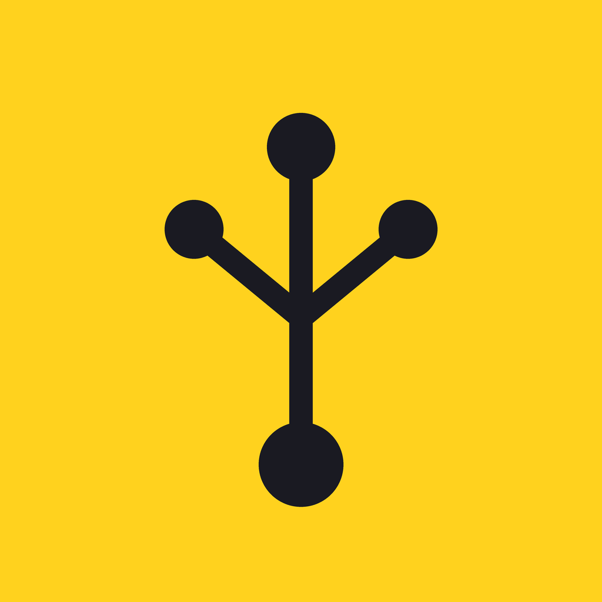
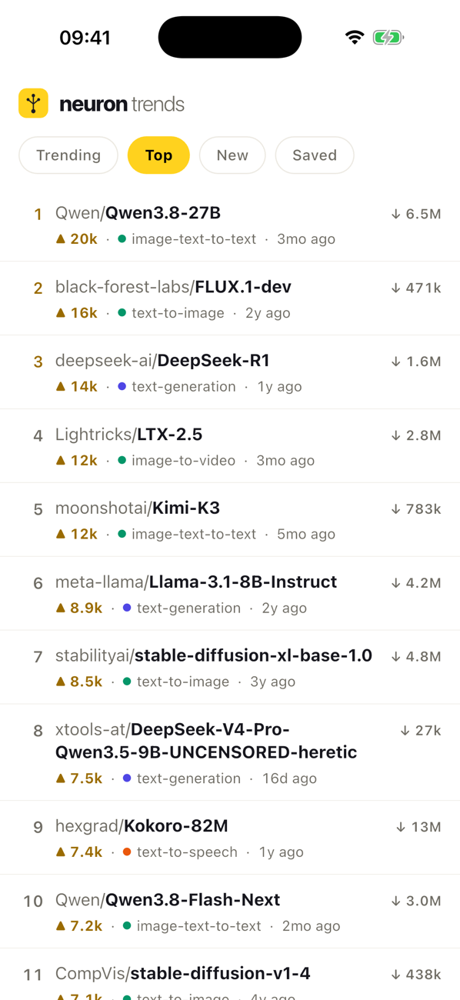
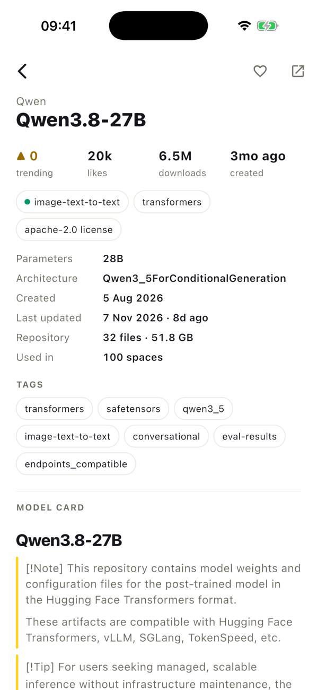
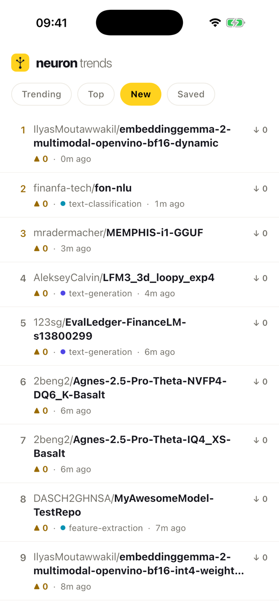

<p align="center"></p>

```text
  ░▒▒▒░                          ░▒▒▒░             |
 ░▒▓●▓▒░                        ░▒▓●▓▒░---------•- ● ... ·           '
  ░▒▒▒░ ·               ·        ░▒▒▒░           / |    '''---...    |     .
     ·    · ·                   ·   \           /  .             ''' ●
              · ·                    \        •                     /
      ·           ·         ·         \      /                    /  ·
      .             · ·                •  ./                  · /
       ·                 ●  · · ·      \ //                    •     ·
        ●               /|        · · · ○ ·                   /
       / |             ' . ·           / \  · · ·      ·    /         ·
      .  |                            /   '       · · · \ /
          |                  ·  .    /                   ○            ·
          •                         /                    | '-.       ·
           |                   ·   •                     ·    '--•    ·
  .        |                      /                               '-. |
            ○ · · · · · · · · ·  ○       ·               .            ○
 ·          |                                             ·

      █▄  █ █▀▀▀ █  █ █▀▀▄ ▄▀▀▄ █▄  █    ▀▀█▀▀ █▀▀▄ █▀▀▀ █▄  █ █▀▀▄ ▄▀▀▀
      █ ▀▄█ █▀▀  █  █ █▄▄▀ █  █ █ ▀▄█      █   █▄▄▀ █▀▀  █ ▀▄█ █  █  ▀▀▄
      ▀   ▀ ▀▀▀▀  ▀▀  ▀  ▀  ▀▀  ▀   ▀      ▀   ▀  ▀ ▀▀▀▀ ▀   ▀ ▀▀▀  ▀▀▀

       ·  new and trending models on hugging face, hacker news style  ·
```

The newest and most talked-about AI models on Hugging Face, in a fast ranked list you read like the front page of Hacker News. No account, no token, no ads: open it and see what is moving.

<p align="center">
  
  &nbsp;
  
  &nbsp;
  
</p>

## What it does

- **Four feeds.** Trending, Top (most liked), New (just uploaded) and Saved.
- **Ranked like a front page.** Every row shows likes, task, age and downloads at a glance.
- **Model detail.** Full metadata, parameter count, every GGUF quantization with its size, and the model card rendered in place.
- **Hold a model and slide it right** to save it. Saved models stay on your phone.
- **Nothing to sign up for.** It reads Hugging Face's public API directly, with no backend of its own.

## Install

Download the APK for your phone from the [latest release](https://github.com/msiciliag/neuron_trends/releases/latest). Most phones want `arm64-v8a`. There is also an unsigned IPA for sideloading on iOS.

## Build it

```bash
flutter pub get
flutter run
```

Built with Flutter 3.41.9. Every push to `main` builds the Android APKs and an unsigned iOS IPA in GitHub Actions and publishes them as a release (`v1.0.<run number>`). The APKs are signed with Flutter's debug key for now.
